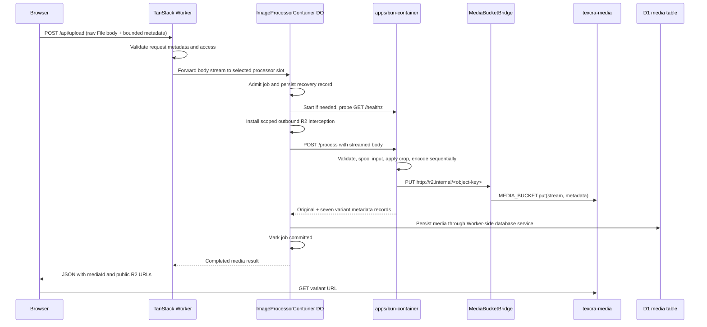

# Image Pre-Processing Flow — Bun Container Implementation Plan

**Status:** Implementation complete; available local checks completed. Shared contracts, Bun processor, streaming Worker/DO/R2 pipeline, D1 persistence, UI integration, and Nitro deployment support are implemented. Docker integration and deployment checks remain pending as recorded below.

## Goal and confirmed decisions

Process uploaded images with Sharp inside a Bun-powered Cloudflare Container. Keep image decoding and encoding outside the Worker's 128 MB isolate; stream image bytes through the Worker and Durable Object. Persist the original and seven variants in R2, then persist their metadata in the existing D1 `media` table.

| Decision                                    | Confirmed value                                               |
| ------------------------------------------- | ------------------------------------------------------------- |
| R2 bucket                                   | `texcra-media`                                                |
| Image delivery                              | Direct public R2 URLs                                         |
| Container control                           | Raw Durable Object Container API: `this.ctx.container`        |
| Container directory                         | `apps/bun-container/`                                         |
| Workspace package name                      | `bun-container`                                               |
| Container runtime                           | Bun, using `Bun.serve`                                        |
| Dependency management and script invocation | pnpm; retain the monorepo's `pnpm-lock.yaml`                  |
| Processing engine                           | Sharp inside the container                                    |
| Application deployment layer                | Preserve Nitro; default Cloudflare, selectable Node.js preset |
| Upload authentication                       | Explicit pass-through hook for now; follow-up work deferred   |
| Public R2 origin                            | Leave `MEDIA_PUBLIC_BASE_URL` unset until configured          |

The container now lives under `apps/bun-container/`, following the approved [directory migration](move-bun-container-to-apps.md). This supersedes the earlier singular `app/` directory decision. The existing `apps/*` workspace glob includes the container; no explicit container entry is required in `pnpm-workspace.yaml`.

Bun is the explicitly requested runtime exception to the repository's general tooling rule. Install dependencies with pnpm and invoke package scripts through `pnpm --filter bun-container run <script>`; do not introduce a Bun lockfile or switch package managers.

`MEDIA_PUBLIC_BASE_URL` is the **R2 public origin**, not a container address. Leave its actual value as a required deployment setting. Production should use a custom domain connected to the bucket; an R2-provided `r2.dev` URL is suitable for development. The container is reached internally through its Durable Object. [R2 public buckets](https://developers.cloudflare.com/r2/buckets/public-buckets/)

## Variant contract

These dimensions, formats, and quality values are confirmed:

| Variant     | Max Width | Max Height | Format | Quality |
| ----------- | --------- | ---------- | ------ | ------- |
| `thumbnail` | 300       | 169        | webp   | 80      |
| `square`    | 500       | 500        | webp   | 80      |
| `small`     | 600       | 338        | webp   | 80      |
| `medium`    | 900       | 506        | webp   | 82      |
| `large`     | 1400      | 788        | webp   | 82      |
| `xlarge`    | 1920      | 1080       | webp   | 85      |
| `og`        | 1200      | 630        | webp   | 85      |

Implemented fit behavior retains the approved plan's intent: crop `thumbnail`, `square`, and `og` to their target aspect ratios; fit `small`, `medium`, `large`, and `xlarge` inside their bounding boxes without additional cropping. Preserve aspect ratio and never enlarge. For undersized cover inputs, compute a smaller target of the same aspect ratio, allowing integer-pixel rounding.

The table defines maximum dimensions. Store the actual encoded width and height, which can be smaller. All seven variants use `.webp` filenames and `image/webp`, including `og`. [Sharp resize behavior](https://sharp.pixelplumbing.com/api-resize/)

## Current repository integration

- `apps/worker/src/server/upload.functions.ts` was replaced by `/api/upload`, which accepts a streamed raw image body and bounded metadata header.
- `apps/worker/src/components/image-upload/use-image-upload.ts` preserves URL callbacks, adds complete media results, reuses retry IDs, and displays an indeterminate upload state.
- `apps/worker/src/db.ts` accepts an explicit D1 binding or obtains it from Nitro's `request.runtime.cloudflare.env`. `runtime-bindings.ts` isolates this platform boundary; the application route and database helper do not import `cloudflare:workers` at runtime.
- `packages/shared/src/db/schema/media.ts` already contains all seven flattened size groups, original metadata, and focal fields. Its `filename` has a unique index.
- `packages/shared` currently exports TypeScript source and its root exports database code. Add a separate image-processing subpath so Bun, browser, and Worker imports do not pull in Drizzle unnecessarily.
- Nitro defaults to `cloudflare-module`, with `NITRO_PRESET=node-server` available for future Node.js deployment. Cloudflare classes remain in `exports.cloudflare.ts`. `scripts/finalize-build.ts` rebases Docker and D1 migration paths in Nitro's generated Wrangler config. The Node build still needs future database/image-processing adapters; it returns a structured 503 for uploads without those bindings.
- The current Wrangler configuration still has a placeholder D1 database ID. Resolve that before a deployed integration test.

## Architecture



The DO runs in the Worker runtime and owns job admission, recovery, and the database commit. The Bun container only processes images and writes objects through the private bridge. It receives no D1 binding or R2 credentials.

## Implementation tasks

### 1. Shared Types Package (`packages/shared`)

Expand the shared-package design from the [reference plan](/home/tien/.gemini/antigravity-cli/brain/bec18076-8430-41ea-8b2e-cc46bdc74977/pre-process-image-plan.md) into the following explicit contract. `packages/shared` owns image-processing types, the seven variant definitions, and pure runtime validators used by the browser, Worker, and Bun container. Keep the agreed dimensions, WebP output, streaming transport, and `apps/bun-container` runtime throughout these contracts.

Planned package layout:

```text
packages/shared/
├── package.json                         # Add the image-processing subpath export
└── src/
    ├── index.ts                         # Preserve existing database exports
    ├── db/                              # Existing schemas remain unchanged
    └── image-processing/
        ├── types.ts                     # Data contracts and adapter interfaces
        ├── variants.ts                  # Single source for all seven variants
        ├── validation.ts                # Pure parsers for network boundaries
        └── index.ts                     # Public image-processing exports
```

#### [NEW] `packages/shared/src/image-processing/types.ts`

Define the following types explicitly. All widths/heights are measured pixels and `filesize` values are byte counts. JSON contracts contain plain data; only the in-process adapter interfaces accept Web Streams and cancellation signals.

```typescript
export type VariantId =
  'thumbnail' | 'square' | 'small' | 'medium' | 'large' | 'xlarge' | 'og'

export type ImageMimeType =
  'image/jpeg' | 'image/png' | 'image/webp' | 'image/avif'

/** Coordinates refer to the EXIF-oriented source before user rotation. */
export interface CropData {
  x: number
  y: number
  width: number
  height: number
  unit: 'px' | '%'
  /** Clockwise degrees, applied after extracting the crop. */
  rotation?: number
}

/** Normalized 0–100 coordinates on the same oriented source. */
export interface FocalPoint {
  x: number
  y: number
}

export interface VariantConfig<V extends VariantId = VariantId> {
  id: V
  width: number
  height: number
  fit: 'cover' | 'inside'
  format: 'webp'
  quality: number
}

export type VariantDefinitions = {
  readonly [V in VariantId]: Readonly<VariantConfig<V>>
}

/** Client-declared metadata; the container must verify the actual image. */
export interface UploadMetadata {
  uploadId: string
  filename: string
  mimeType: ImageMimeType
  filesize: number
  crop?: CropData
  focalPoint?: FocalPoint
}

/** Generated by the Worker and persisted by the DO before processing. */
export interface ObjectKeyPlan {
  original: string
  variants: Record<VariantId, string>
}

export interface ProcessImageMetadata extends UploadMetadata {
  objectKeys: ObjectKeyPlan
}

export interface StoredImageMetadata {
  r2Key: string
  filename: string
  mimeType: ImageMimeType
  filesize: number
  width: number
  height: number
}

export interface ProcessedVariant<
  V extends VariantId = VariantId,
> extends StoredImageMetadata {
  id: V
  format: 'webp'
  mimeType: 'image/webp'
}

/** A complete record whose keys also constrain each variant's id. */
export type ProcessedVariants = {
  [V in VariantId]: ProcessedVariant<V>
}

export interface ProcessImageResult {
  uploadId: string
  original: StoredImageMetadata
  /** Source focal point, defaulting to 50/50, for D1 storage. */
  focalX: number
  focalY: number
  variants: ProcessedVariants
}

export type PublicImageMetadata = Omit<StoredImageMetadata, 'r2Key'> & {
  url: string
}

export type PublicVariants = {
  [V in VariantId]: Omit<ProcessedVariant<V>, 'r2Key'> & { url: string }
}

/** Worker response after the D1 commit; the inherited url is the original. */
export interface UploadImageResponse extends PublicImageMetadata {
  mediaId: number
  uploadId: string
  thumbnailURL: string
  focalX: number
  focalY: number
  variants: PublicVariants
}

export type UploadErrorCode =
  | 'INVALID_INPUT'
  | 'UNSUPPORTED_FORMAT'
  | 'UPLOAD_TOO_LARGE'
  | 'UNAUTHORIZED'
  | 'FORBIDDEN'
  | 'PROCESSOR_BUSY'
  | 'CONTAINER_START_FAILED'
  | 'PROCESSING_TIMEOUT'
  | 'STORAGE_FAILED'
  | 'PERSISTENCE_FAILED'
  | 'INTERNAL_ERROR'

export interface UploadErrorResponse {
  uploadId?: string
  error: {
    code: UploadErrorCode
    message: string
    retryable: boolean
  }
}

/** Implemented by SharpImageProcessor in apps/bun-container. */
export interface IImageProcessor {
  processImage(
    imageStream: ReadableStream<Uint8Array>,
    metadata: ProcessImageMetadata,
    signal?: AbortSignal,
  ): Promise<ProcessImageResult>
}

export interface StorageWrite {
  r2Key: string
  body: ReadableStream<Uint8Array>
  contentType: ImageMimeType
  contentLength: number
}

/** Injected into the processor; implemented by the private R2 bridge client. */
export interface IImageStorage {
  putObject(object: StorageWrite, signal?: AbortSignal): Promise<void>
}
```

Keep `focalPoint` solely on `UploadMetadata`; `CropData` describes the crop and optional rotation. The processor transforms focal coordinates for each output but returns the source focal point in `focalX`/`focalY`, as required by the persistence task. `ProcessImageResult` contains object keys and measured metadata. The Worker constructs `UploadImageResponse` URLs from validated keys and `MEDIA_PUBLIC_BASE_URL` after committing the row.

The complete mapped records require all seven variants and match each record key to its `id`. Reject missing, extra, or mismatched variants at runtime as well. Keep dimensions and sizes as numbers in these contracts; any conversion required by the existing Drizzle schema belongs in `apps/worker/src/server/media.ts`.

#### [NEW] `packages/shared/src/image-processing/variants.ts`

Use one readonly configuration, with the confirmed dimensions/quality and the proposed fit behavior from the variant contract above:

```typescript
import type { VariantDefinitions } from './types'

export const DEFAULT_VARIANTS = {
  thumbnail: {
    id: 'thumbnail',
    width: 300,
    height: 169,
    fit: 'cover',
    format: 'webp',
    quality: 80,
  },
  square: {
    id: 'square',
    width: 500,
    height: 500,
    fit: 'cover',
    format: 'webp',
    quality: 80,
  },
  small: {
    id: 'small',
    width: 600,
    height: 338,
    fit: 'inside',
    format: 'webp',
    quality: 80,
  },
  medium: {
    id: 'medium',
    width: 900,
    height: 506,
    fit: 'inside',
    format: 'webp',
    quality: 82,
  },
  large: {
    id: 'large',
    width: 1400,
    height: 788,
    fit: 'inside',
    format: 'webp',
    quality: 82,
  },
  xlarge: {
    id: 'xlarge',
    width: 1920,
    height: 1080,
    fit: 'inside',
    format: 'webp',
    quality: 85,
  },
  og: {
    id: 'og',
    width: 1200,
    height: 630,
    fit: 'cover',
    format: 'webp',
    quality: 85,
  },
} as const satisfies VariantDefinitions
```

The Bun adapter imports this configuration directly and always disables enlargement. The Worker uses the same definitions to validate results. Variant definitions, object keys, bucket configuration, and key prefixes are server-owned; the upload request cannot override them. An implementation may derive an iteration list from this object, but must not maintain a second configuration or serialize client-selected variants into the processing request.

#### [NEW] `packages/shared/src/image-processing/validation.ts`

Implement pure parsers with these exported signatures; each accepts `unknown`, validates it, and returns the corresponding typed value:

```typescript
import type {
  ProcessImageMetadata,
  ProcessImageResult,
  UploadErrorResponse,
  UploadImageResponse,
  UploadMetadata,
} from './types'

// Signatures only; implementation supplies the parser bodies.
export declare function parseUploadMetadata(input: unknown): UploadMetadata
export declare function parseProcessImageMetadata(
  input: unknown,
): ProcessImageMetadata
export declare function parseProcessImageResult(
  input: unknown,
  expected: ProcessImageMetadata,
): ProcessImageResult
export declare function parseUploadImageResponse(
  input: unknown,
): UploadImageResponse
export declare function parseUploadErrorResponse(
  input: unknown,
): UploadErrorResponse
```

Validation responsibilities:

- Check UUIDs, safe bounded filenames, allowed MIME declarations, positive integer byte counts, finite crop/rotation values, explicit crop units, and focal coordinates within 0–100. Validate crop bounds against actual oriented dimensions inside the processor after decoding metadata.
- Reject unknown upload fields, including client-provided variants, object keys, URLs, or storage settings. The Worker adds the trusted `ObjectKeyPlan`; the DO records it and the container validates the internal request before invoking its adapter.
- Validate container results against the expected upload identity and keys, complete variant records, matching IDs, `image/webp`, positive measured dimensions/lengths, and configured maximum dimensions. The processor still verifies actual bytes, format, and dimensions; a parser cannot prove that an R2 object exists.
- Validate the public response's media ID, original metadata, complete URL-bearing variants, and consistent thumbnail URL. Parse success/error JSON at the browser boundary without treating a type assertion as validation.
- Enforce encoded header size, actual streamed byte limits, authorization, and deadlines in the transport/runtime layers. Share validation logic without importing a runtime-specific request, environment, database, or storage binding into this package.

Use small pure validation helpers for this bounded contract; no new validation-library dependency is required. Translate validation failures into the shared error envelope at the relevant HTTP boundary. Keep messages suitable for the client, with internal diagnostics in Worker/container logs.

#### [NEW] `packages/shared/src/image-processing/index.ts`

```typescript
export type * from './types'
export { DEFAULT_VARIANTS } from './variants'
export {
  parseUploadMetadata,
  parseProcessImageMetadata,
  parseProcessImageResult,
  parseUploadImageResponse,
  parseUploadErrorResponse,
} from './validation'
```

#### [MODIFY] `packages/shared/package.json`

Extend the existing source export map:

```json
{
  "exports": {
    ".": "./src/index.ts",
    "./image-processing": "./src/image-processing/index.ts"
  }
}
```

Preserve the existing package name `shared`, database dependencies, `typecheck` script, and source-based module setup. `packages/shared/src/index.ts` continues to export `./db/index`; image-processing consumers use the dedicated subpath. Shared code requires no emitted build output and no Bun, Sharp, Cloudflare, or Node filesystem dependencies. Keep standard Web Stream/AbortSignal types available in each consumer's TypeScript configuration and check the actual imports in both applications.

#### Consumer responsibilities and imports

| Consumer                                    | Imports from `shared/image-processing`                                                  | Responsibility                                                                                    |
| ------------------------------------------- | --------------------------------------------------------------------------------------- | ------------------------------------------------------------------------------------------------- |
| Browser upload helper and image-upload hook | `UploadMetadata`, `UploadImageResponse`, `UploadErrorResponse`, public response parsers | Send raw bytes plus permitted metadata; display returned URLs and expose completed media metadata |
| Worker upload route and DO                  | Metadata/result types and parsers, `DEFAULT_VARIANTS`, `ObjectKeyPlan`                  | Validate boundaries, assign keys, coordinate processing/recovery, and reject incomplete results   |
| Worker media service                        | `ProcessImageResult`, `UploadImageResponse`, `VariantId`                                | Construct R2 public URLs and explicitly map metadata into existing D1 columns                     |
| Bun server and `SharpImageProcessor`        | `IImageProcessor`, processing metadata/result types, parsers, `DEFAULT_VARIANTS`        | Validate the internal request and produce all seven variants using the shared contract            |
| Bun `R2BridgeStorage` adapter               | `IImageStorage`, `StorageWrite`                                                         | Stream known-length objects through the scoped private bridge                                     |

Declare `shared: workspace:*` in both application packages, preserving an existing dependency where present. Use `import type { ... } from 'shared/image-processing'` for contracts and ordinary imports for configuration/parsers. Construct `SharpImageProcessor` with an `IImageStorage` implementation inside Bun; keep HTTP transport, temporary files, Sharp, and R2 bridge details in `apps/bun-container`. Database schemas, environment access, and Cloudflare bindings remain in the Worker dependency graph. The image-processing subpath must be safe to import from the browser without relying on tree-shaking to remove database or container code.

### 2. Bun application and monorepo packaging

Create `apps/bun-container/` with `package.json`, `tsconfig.json`, `Dockerfile`, source, and focused tests.

Proposed package scripts:

```json
{
  "name": "bun-container",
  "private": true,
  "type": "module",
  "scripts": {
    "dev": "bun --watch src/server.ts",
    "start": "bun src/server.ts",
    "typecheck": "tsc --noEmit",
    "test": "bun test"
  }
}
```

Use `shared: workspace:*`, `sharp`, TypeScript, and Bun types. Select and pin compatible Bun/image/dependency versions during implementation. Configure TypeScript for Bun and source imports; Bun executes the TypeScript entrypoint directly, so the plan does not depend on a nonexistent `dist/server.js`.

Docker requirements:

- Use a pinned Debian-based `oven/bun` runtime image and a pnpm dependency stage with a compatible Linux architecture and libc.
- Set Docker build context to the repository root. Copy root workspace manifests, the lockfile, `packages/shared`, and `apps/bun-container` as needed.
- Install with pnpm and a frozen lockfile. Preserve pnpm's workspace symlinks and the shared source when copying dependencies into the runtime image.
- Install Sharp's Linux native optional packages in the image. Use its supplied libvips binaries; add system libraries only if a verified dependency requires them.
- Run a Sharp import and actual WebP encode smoke test under Bun in the built image. A successful typecheck alone is insufficient.
- Run the server as a non-root user, bind `0.0.0.0:3001`, and launch the Bun binary directly as the container process, for example `CMD ["bun", "src/server.ts"]`.
- Add a scoped Docker ignore file to exclude local dependencies, build output, secrets, and `agent-do-not-touch` from the build context without reading that folder.

Bun supports container deployment, while Sharp requires compatible native binaries. The runtime smoke test verifies the selected combination. [Bun Docker guide](https://bun.sh/guides/ecosystem/docker), [Sharp installation](https://sharp.pixelplumbing.com/install/)

### 3. Streaming upload boundary and UI

Replace the upload transport with a TanStack server route at `apps/worker/src/routes/api/upload.ts`:

1. The browser sends the `File` directly as the POST body, with bounded, UTF-8-safe encoded metadata in a header. Include a UUID for the logical upload; reuse it only when retrying that same file and processing options.
2. Validate the request's access, origin, content type, metadata shape, and declared byte count before starting a container. Apply the site's upload authorization policy at the handler boundary.
3. Forward `request.body` without `formData()`, `arrayBuffer()`, base64 conversion, or an unbounded `tee()`. Check declared length early and enforce the actual streamed byte count.
4. Select a bounded processor slot and forward only trusted metadata and required headers. Never forward browser cookies or authorization headers into the container.
5. Return `UploadImageResponse` on success or `UploadErrorResponse` on failure. Include `mediaId`, `uploadId`, original `url`, `thumbnailURL`, focal metadata, and all seven variants in a successful response.

A `File.stream()` call after multipart parsing does not establish an end-to-end streaming guarantee. A raw HTTP server route gives the application control of the unconsumed request body. [TanStack server routes](https://tanstack.com/start/latest/docs/framework/react/guide/server-routes)

Add a browser upload helper and update `use-image-upload.ts` to consume the new response. Keep the component's existing URL-based `onChange` and custom `onUpload(file): Promise<string>` contract; the built-in uploader can select the `large` variant as its preview URL. Provide an optional completion callback for callers needing `mediaId` and full metadata.

Remove the old base64 server function after migrating its caller. Replace simulated progress with an indeterminate uploading/processing state, or actual transport progress if available. Do not claim that completed byte transfer means processing has finished.

No crop editor is added in this task; accept optional crop/focal metadata in the transport and use defaults for the existing UI.

### 4. Durable Object lifecycle and bounded admission

Create `ImageProcessorContainer extends DurableObject<Env>` and use the raw API:

- Coordinate startup; call `start({ enableInternet: false })` only when stopped. A running container is not necessarily ready.
- Probe `GET /healthz` using `getTcpPort(3001).fetch(...)` with a bounded readiness deadline.
- Use parameterless `monitor()` to observe exit/failure, not HTTP readiness.
- Set `setInactivityTimeout(...)` after start and restore it when a reconstructed DO finds a running container.
- Forward accepted upload streams to `/process`. On an unrecoverable timeout, stop the job and destroy its container before reusing the slot.

These are raw API operations; remove the previous draft's SDK helpers and invalid `monitor("/process", ...)` call. [Durable Object Container API](https://developers.cloudflare.com/containers/api/durable-object-container/)

Proposed admission policy: five deterministic slots, one active job per slot, and sequential variant encoding within each job. Hash the upload UUID to a slot. A busy slot returns a retryable response before the application consumes the body; there is no unbounded in-memory queue or automatic replay of a consumed stream. Persist job identity and state so a DO restart cannot accidentally admit a second job into a still-busy container.

On reconstruction, reconcile the persisted job with the container before admitting work. Startup failure, client cancellation, process exit, and processing timeout must release admission only after the old job can no longer write objects.

`max_instances` caps containers but does not implement routing or application admission. [Container scaling and routing](https://developers.cloudflare.com/containers/configuration/scaling-and-routing/)

### 5. Private R2 write bridge and public delivery

Export `MediaBucketBridge extends WorkerEntrypoint<Env, BridgeProps>`. Register a scoped fetcher using:

```typescript
await this.ctx.container.interceptOutboundHttp(
  'r2.internal',
  this.ctx.exports.MediaBucketBridge({
    props: { uploadId, allowedKeys },
  }),
)
```

Install the interception before processing and reapply it for each new container/job. This is the raw API replacement for the draft's static `outboundByHost` map. [Outbound interception API](https://developers.cloudflare.com/containers/api/durable-object-container/#interceptoutboundhttp)

The bridge accepts PUTs only for the current job's expected keys and allowed content types. Stream bodies into `MEDIA_BUCKET.put`, validate byte limits, and preserve a known content length for R2's streaming requirements. If a counting wrapper is required, use the runtime's fixed-length stream support rather than buffering. Container code uploads to `http://r2.internal`; cleanup remains under Worker/DO control.

Generate immutable keys with full UUIDs and safe filenames, for example `media/<upload-id>/<upload-id>-large.webp`. Use a globally unique original filename as well because the existing DB has a unique filename index. Set content type and cache metadata on each object.

Retain the earlier proposal's original upload plus seven variants: eight objects total. The original is also public when stored in this bucket. Crop/rotation affects the generated variants; the original remains the uploaded source. If originals must be private or discarded, revise that storage decision before implementing it.

### 6. Sharp processing under Bun

The Bun HTTP server exposes `GET /healthz` and internal `POST /process`. Configure explicit request size and idle timeouts; processing can outlast Bun's default idle timeout. Use an independent job deadline and cancellation handling. [Bun HTTP server](https://bun.sh/docs/runtime/http/server), [Bun Serve options](https://bun.sh/reference/bun/Serve)

Proposed initial limits, to validate with fixtures and load measurements:

| Limit                                      | Initial value                  |
| ------------------------------------------ | ------------------------------ |
| Encoded input                              | 20 MiB                         |
| Decoded input                              | 40 megapixels                  |
| Metadata header                            | 4 KiB after transport encoding |
| Container startup deadline                 | 30 seconds                     |
| Processing/upload deadline after readiness | 120 seconds                    |
| Warm container inactivity timeout          | 5 minutes                      |
| Concurrent jobs per container              | 1                              |
| Concurrent variant encodes per job         | 1                              |

Pipeline:

1. Spool the upload to a temporary file with backpressure and a byte counter. Keep original bytes, decoded pixels, and encoded variants out of Worker/DO memory.
2. Detect the actual image format and dimensions with Sharp; do not trust MIME type or filename. Initially accept single-frame JPEG, PNG, WebP, and AVIF. Reject unsupported, animated/multipage, corrupt, oversized, or excessive-pixel inputs with a clear error.
3. Auto-orient from EXIF. Define crop coordinates against this oriented source, before any user-requested rotation. Accept either pixels or percentages with an explicit `unit`; reject non-finite, empty, or out-of-bounds rectangles.
4. Keep focal input separate from crop: normalized 0–100 coordinates on the oriented source, defaulting to the center. Crop first, then apply validated clockwise rotation. Transform focal coordinates through the same operations.
5. For cover outputs, compute a bounded extraction rectangle around the transformed focal point before resizing. Do not pass CSS percentage strings as Sharp's `position`. For inside outputs, preserve the full working image.
6. Encode variants sequentially to temporary files, record actual dimensions and bytes, and upload each with a known length. Strip metadata from generated variants and preserve transparency.
7. Store normalized source focal coordinates with the original's metadata in D1; use transformed coordinates only for variant crops. Report original dimensions consistently with its EXIF-oriented display.
8. Remove temporary files in `finally`, including on cancellation or error. Limit Sharp's cache/concurrency and record peak memory during verification.

The processor remains bounded by the selected container's memory and disk. Avoid the old draft's unbounded input chunk collection and seven-way `Promise.all`. Sharp's documented positions are named positions/gravity/strategies; focal coordinates require explicit geometry. [Sharp resizing and extraction](https://sharp.pixelplumbing.com/api-resize/)

### 7. D1 persistence and failure recovery

Create a Worker-side media service and call it from the DO after all object writes succeed. Adapt the existing DB helper to accept an explicit binding when needed, keeping normal Worker callers working.

Map original metadata to `url`, `filename`, `mimeType`, `filesize`, `width`, `height`, `focalX`, and `focalY`. Set `thumbnailURL` to the thumbnail variant URL. Map each variant to its existing six `sizes<Variant>*` columns: URL, width, height, MIME type, filesize, and filename. Handle the installed Drizzle schema's `numeric` representation explicitly.

Validate exactly seven distinct variants, expected keys, WebP content types, positive measured dimensions/lengths, and required metadata before inserting. Use a typed explicit column mapping and return the inserted `mediaId`. No D1 schema migration is expected.

R2 and D1 do not share a transaction:

- Persist a DO recovery record before processing with upload identity, original filename, expected object keys, and job state.
- On partial processing or upload failure, stop writes, delete the objects for that attempt, and retain failed cleanup work for retry.
- If the D1 commit outcome is uncertain, query by the unique original filename before deleting any objects. A committed row wins and its objects must be preserved.
- Recover interrupted commits from stored result metadata; retries for a completed logical upload return the existing result.
- Use a DO alarm for unresolved cleanup/reconciliation, with bounded retries and diagnostic logging. Serialize recovery with job admission and finalization.
- Return success only after the row and committed state are recorded. Never report full atomicity across R2 and D1.

Use the shared `UploadErrorCode` union and `UploadErrorResponse` envelope for invalid input, unsupported format, oversized upload, access failures, busy processor, startup failure, processing timeout, storage failure, and persistence failure. Log upload ID and stage without image bytes or credentials.

### 8. Wrangler, bindings, and Nitro exports

Keep `apps/worker/wrangler.toml` as the configuration source. Proposed additions, with paths relative to that file:

```toml
compatibility_flags = ["nodejs_compat", "enable_ctx_exports"]

[[containers]]
class_name = "ImageProcessorContainer"
scheduling_policy = "default"
image = "../bun-container/Dockerfile"
image_build_context = "../.."
instance_type = "standard-1"
max_instances = 5

[[durable_objects.bindings]]
name = "IMAGE_PROCESSOR"
class_name = "ImageProcessorContainer"

[exports.ImageProcessorContainer]
type = "durable-object"
storage = "sqlite"

[[r2_buckets]]
binding = "MEDIA_BUCKET"
bucket_name = "texcra-media"

[vars]
# MEDIA_PUBLIC_BASE_URL must be set to the actual public R2 origin.
```

Merge these into the existing file; do not duplicate its `[vars]` table or replace D1 settings. Select a current tested compatibility date during implementation and verify existing application behavior.

The raw Container API works with the `default` scheduling policy; this keeps image, instance size, and the instance ceiling in Wrangler. `standard-1` is an initial resource choice to validate, not an unlimited-memory assumption. The explicit root build context is necessary for workspace copies. [Wrangler container configuration](https://developers.cloudflare.com/workers/wrangler/configuration/#containers), [Container instance limits](https://developers.cloudflare.com/containers/platform/limits/)

Current Cloudflare guidance supports declaring new SQLite-backed DO classes through `exports`. This Worker has no existing DO migration history in its config. Use this declaration alone; do not combine it with legacy `[[migrations]]` or the draft's `new_classes`. [Durable Object class exports](https://developers.cloudflare.com/durable-objects/reference/durable-objects-migrations/)

Add `apps/worker/exports.cloudflare.ts` with named re-exports of both `ImageProcessorContainer` and `MediaBucketBridge`. Configure Nitro's `cloudflare.exports` explicitly if needed. Keep the application handler as Nitro's default export. Generate bindings with Wrangler, including `ctx.exports` types; the loopback export mechanism requires `enable_ctx_exports`. [Workers context API](https://developers.cloudflare.com/workers/runtime-apis/context/#exports)

## File change map

| Path                                                          | Planned change                                                                   |
| ------------------------------------------------------------- | -------------------------------------------------------------------------------- |
| `pnpm-workspace.yaml`                                         | Discover the container via `apps/*`; preserve native dependency build allowances |
| `pnpm-lock.yaml`                                              | Record new workspace dependencies using pnpm                                     |
| `packages/shared/package.json`                                | Add `shared/image-processing` export; preserve existing root export              |
| `packages/shared/src/image-processing/types.ts`               | Data contracts, complete variant records, error types, and adapter interfaces    |
| `packages/shared/src/image-processing/variants.ts`            | Canonical definitions for the seven confirmed WebP variants                      |
| `packages/shared/src/image-processing/validation.ts`          | Pure runtime parsers for upload, processing, and public response boundaries      |
| `packages/shared/src/image-processing/index.ts`               | Explicit type, configuration, and parser exports                                 |
| `apps/bun-container/package.json`                             | Bun runtime scripts and dependencies                                             |
| `apps/bun-container/tsconfig.json`                            | Bun-aware typechecking                                                           |
| `apps/bun-container/Dockerfile`                               | Workspace-aware Bun image                                                        |
| `apps/bun-container/Dockerfile.dockerignore`                  | Restrict the root build context                                                  |
| `apps/bun-container/src/server.ts`                            | Bun HTTP server, readiness, limits, cancellation                                 |
| `apps/bun-container/src/processor.ts`                         | `SharpImageProcessor` implementing shared `IImageProcessor`                      |
| `apps/bun-container/src/storage.ts`                           | `R2BridgeStorage` implementing shared `IImageStorage`                            |
| `apps/bun-container/tests/*`                                  | Shared contract validation, processing, and Bun runtime integration cases        |
| `apps/worker/exports.cloudflare.ts`                           | Export DO and bridge in the Worker entrypoint                                    |
| `apps/worker/src/server/image-processor.ts`                   | Raw Container lifecycle, job coordination, recovery                              |
| `apps/worker/src/server/media-bucket-bridge.ts`               | Scoped streaming writes through R2 binding                                       |
| `apps/worker/src/server/media.ts`                             | Result validation, public URL construction, D1 mapping                           |
| `apps/worker/src/routes/api/upload.ts`                        | Raw streaming upload endpoint                                                    |
| `apps/worker/src/lib/upload-image.ts`                         | Browser transport and typed response handling                                    |
| `apps/worker/src/server/upload.functions.ts`                  | Remove after its caller migrates                                                 |
| `apps/worker/src/components/image-upload/use-image-upload.ts` | Consume response, preserve URL callbacks, expose media result                    |
| `apps/worker/src/db.ts`                                       | Support an explicit D1 binding for DO-side persistence                           |
| `apps/worker/wrangler.toml`                                   | Container, DO, R2, runtime flags, public origin                                  |
| `apps/worker/vite.config.ts`                                  | Nitro export integration if explicit configuration is needed                     |
| `apps/worker/worker-configuration.d.ts`                       | Generated binding/runtime types                                                  |
| `apps/worker/package.json`                                    | Preserve/add `shared: workspace:*` and add the focused upload test script        |
| Worker test files                                             | Focused upload, lifecycle, bridge, and persistence verification                  |
| `README.md`                                                   | Document Bun runtime prerequisites, pnpm commands, and local container workflow  |

The existing `media` schema and `packages/shared/src/index.ts` retain their current database behavior. Preserve unrelated workspace changes and exclude `agent-do-not-touch` from inspection and build inputs.

## Approved execution order

1. Add shared types, canonical variants, pure validators, and the `shared/image-processing` export; typecheck the shared package.
2. Add the workspace entry and Bun container skeleton; wire `SharpImageProcessor` and `R2BridgeStorage` to the shared interfaces.
3. Build the container and verify Bun can resolve the shared source, load Sharp, and generate all seven outputs.
4. Add raw DO lifecycle, scoped R2 bridge, configuration, and Nitro exports; verify the built Worker entrypoint.
5. Add streaming upload transport and the existing UI adapter using the shared request/response types and validators.
6. Complete D1 mapping, durable recovery, cancellation, and resource limits.
7. Run focused tests and the local end-to-end workflow; document required deployment values.
8. Configure the actual public R2 origin and real D1 binding for the deployment environment, then verify public image delivery during rollout.

## Verification and acceptance

Use `--config.verify-deps-before-run=false` with pnpm checks to avoid pnpm 11 automatically installing changed manifests. Install dependencies explicitly with `pnpm install --frozen-lockfile` once the lockfile is reconciled. The implementation adds focused unit tests, native Bun tests, a large-upload measurement, and an isolated real local D1 integration test.

```bash
pnpm --filter shared run typecheck
pnpm --filter worker exec wrangler types worker-configuration.d.ts
pnpm run typecheck
pnpm --filter bun-container run test
pnpm --filter worker run test:image-upload
pnpm --filter worker run build
docker build --platform linux/amd64 -f apps/bun-container/Dockerfile -t texcra-bun-container .
pnpm --filter worker exec wrangler deploy --dry-run
pnpm --filter worker exec wrangler dev
```

The `test:image-upload`, `test:image-d1`, and container `test:large` scripts are implemented. Typecheck, image build, and tests exercise the pinned Bun/Sharp runtime and generated Cloudflare types. Use a local Docker-compatible engine with Wrangler; local container support does not require `wrangler dev --remote`. Local `max_instances` enforcement differs from deployment, so admission logic has explicit tests. [Container local development](https://developers.cloudflare.com/containers/guides/local-dev/)

Acceptance cases:

- Resolve `shared/image-processing` from the browser, Worker, and final Bun image. Typecheck both application consumers and verify the browser import graph excludes Drizzle, Sharp, Bun runtime modules, and Cloudflare bindings.
- Exercise the shared parsers with missing/extra/mismatched variant IDs, unexpected object keys, mismatched upload identities, invalid numeric values, client attempts to override configuration, and malformed success/error payloads. Reuse these contract cases in the existing application test suites planned above.
- Confirm all seven IDs, dimensions bounded by the table, correct aspect/fit behavior, WebP signatures, and measured metadata. Include landscape, portrait, square, transparency, tiny input, EXIF rotation, crop, focal-edge, and rotation fixtures.
- Reject malformed metadata, invalid crops, MIME spoofing, unsupported/animated images, truncation, input over the byte limit, and excessive decoded pixels.
- Exercise cold and warm startup, concurrent requests, busy slots, idle shutdown, DO reconstruction, client cancellation, and timeouts.
- Inject partial R2 failures, uncertain D1 commits, and failed cleanup; verify retry/recovery never deletes objects referenced by a committed row.
- Verify the complete serialized response, all flattened D1 size columns, and the existing upload component's URL callback.
- Run a 10–20 MiB upload and concurrent uploads while measuring Worker and container memory. Confirm no whole-image buffering in Worker/DO code.
- Validate named class exports, root Docker context, workspace imports, and native Sharp loading in the final image.
- Verify public R2 reads through the configured origin without Worker read proxying, including MIME/cache metadata. Local emulated R2 alone cannot prove production public-domain setup.

## Approved decisions and remaining environment checks

The bucket, public serving model, variant dimensions/quality, raw Container API, and Bun directory/runtime choices are settled.

The user approved execution of this plan, including fit/no-upscale behavior, original retention, initial limits, and five-slot sizing. `MEDIA_PUBLIC_BASE_URL` stays unset as explicitly requested.

The user explicitly requested an empty authentication pipeline for now. `upload-authorization.ts` is an intentional pass-through hook; authentication will be planned separately.

Nitro is preserved for future Node.js deployment. The `node-server` preset builds, starts, and serves the home page; uploads return a structured 503 until that deployment has image-processing and database adapters. The default Cloudflare build retains the Durable Object and bridge exports.

Verification completed:

- Shared contracts: 23 passing tests; source and test typechecking included.
- Bun processor: 27 passing tests covering native Sharp processing, HTTP transport, cancellation, input limits, geometry, and storage failures; package typecheck passes.
- Worker upload pipeline: 30 passing tests, including 12 durable recovery cases.
- One real local D1 integration test passes: the binding round-trips the original and all seven variants, and duplicate insertion returns the same row.
- A 15,026,066-byte PNG produced all seven variants in 1,359 ms with Bun 1.4.3 and Sharp 0.35.5. Peak sampled RSS was 113,528,832 bytes and peak sampled JS heap was 6,659,725 bytes. This single-process measurement includes the HTTP client, fixture generation, processor, and disk sink; it does not measure Worker memory or the Docker image.
- Cloudflare and Node Nitro builds pass. The local Worker confirms that Nitro's request adapter exposes the configured public-origin setting. The Node smoke check serves `/` with HTTP 200 and returns the expected upload configuration error.
- Wrangler dry run passes with `--containers-rollout=none`, including correctly resolved Docker context and named bindings. This excludes the image build.
- Existing framework/Drizzle lockfile resolutions are preserved; frozen installation succeeds. Browser bundles contain no image-processing server/runtime dependencies.

Pending environment-dependent verification:

- Docker is installed but `/var/run/docker.sock` denies this user's access. The final image build, complete Wrangler-to-container-to-R2 upload, cold/warm container lifecycle, and Worker memory measurement require a usable Docker engine.
- Public R2 delivery and deployed D1 checks require the real public origin and D1 database ID; neither was invented or deployed.
- Whole-app Worker typecheck reports three existing Lexical `Element.append` type conflicts at `src/lexical/-image-node.tsx:129`, `:133`, and `src/lexical/document/-document-export.ts:46`. The same errors reproduce with the original generated Worker types and Bun declarations excluded. Image-processing source and tests introduce no additional errors.
