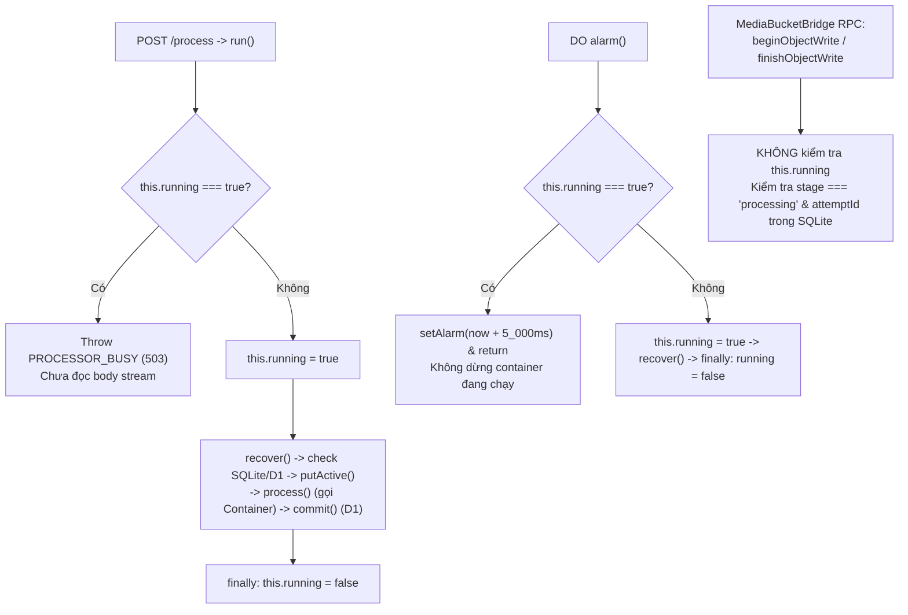

# Plan: Phân tích vai trò của `private running = false` trong `ImageJobCoordinator`

**Trạng thái:** Chờ người dùng duyệt / làm rõ; chưa thực hiện thay đổi code.

## 1. Kết luận cốt lõi (Crucial Determinants)

1. **Áp dụng trực tiếp lên đâu?**
   - Áp dụng **trực tiếp lên từng Durable Object (DO) instance** ([`ImageJobCoordinator`](file:///home/tien/Documents/code/texcra/apps/worker/src/server/image-job-coordinator.ts#L29-L30) nằm trong [`ImageProcessorContainer`](file:///home/tien/Documents/code/texcra/apps/worker/src/server/image-processor.ts#L11-L26)).
   - Đây là **in-memory non-reentrant lock (cờ khóa trong RAM)** để chặn các lời gọi bất đồng bộ đan xen (`fetch` -> `run()` và `alarm()`) khi DO đang `await` I/O (SQLite recovery, D1, R2, hoặc Container).

```typescript
/** The journal is durable; running only serializes the current object's invocations. */
export class ImageJobCoordinator {
  private running = false
```

2. **Áp dụng lên DO hay Container?**
   - **Cơ chế khóa nằm ở DO**, nhưng **hiệu lực bảo vệ áp dụng lên cả cặp 1-1 (DO Slot + Container Instance)**:

| Tầng | Cơ chế khóa đơn tiến trình | Phạm vi bảo vệ |
| --- | --- | --- |
| **Durable Object** ([`image-job-coordinator.ts`](file:///home/tien/Documents/code/texcra/apps/worker/src/server/image-job-coordinator.ts#L45-L50)) | `private running = false` (RAM) + khóa `'active'` trong SQLite ([`image-job-store.ts`](file:///home/tien/Documents/code/texcra/apps/worker/src/server/image-job-store.ts#L33-L41)) | Chặn request thứ 2 vào cùng 1 DO slot ngay từ cửa (`503 PROCESSOR_BUSY`) trước khi đọc stream, ghi đè SQLite `'active'`, hoặc ghi đè `ctx.container.interceptOutboundHttp('r2.internal', ...)`. Đồng thời ngăn `alarm()` gọi `recover() -> stop()` giết nhầm container đang chạy. |
| **Container** ([`server.ts`](file:///home/tien/Documents/code/texcra/apps/bun-container/src/server.ts#L68-L91), [`processor.ts`](file:///home/tien/Documents/code/texcra/apps/bun-container/src/processor.ts#L61-L160)) | `let active = false`, `private busy = false`, `sharp.concurrency(1)` | Tự khóa độc lập bên trong Bun/Sharp để đảm bảo chỉ xử lý 1 ảnh tại 1 thời điểm trong container đó. |
| **Toàn hệ thống** ([`upload-handler.ts`](file:///home/tien/Documents/code/texcra/apps/worker/src/server/upload-handler.ts#L16-L21)) | Hash `uploadId` vào 5 slot (`image-processor-0` .. `image-processor-4`) | `running` chỉ khóa **1 slot DO/Container**, toàn hệ thống vẫn chạy song song tối đa 5 tiến trình trên 5 slot. |

## 2. Luồng kiểm soát của `running` trong DO



## 3. Các vị trí quyết định trong code

- **Chặn request trùng vào cùng DO slot** ([`image-job-coordinator.ts`](file:///home/tien/Documents/code/texcra/apps/worker/src/server/image-job-coordinator.ts#L45-L50)):

```typescript
if (this.running)
  throw new ImageProcessingError(
    'PROCESSOR_BUSY',
    'This image processor is busy. Retry this upload shortly.',
  )
this.running = true
```

- **Chặn `alarm()` cắt ngang job đang chạy** ([`image-job-coordinator.ts`](file:///home/tien/Documents/code/texcra/apps/worker/src/server/image-job-coordinator.ts#L179-L192)):

```typescript
async alarm(): Promise<void> {
  if (this.running) {
    await this.setAlarm(Date.now() + 5_000)
    return
  }
  this.running = true
  try {
    await this.recover()
  } catch (error) {
    await this.retryLater(error)
  } finally {
    this.running = false
  }
}
```

- **Cho phép RPC từ `MediaBucketBridge` đi qua khi `running === true`** ([`image-job-coordinator.ts`](file:///home/tien/Documents/code/texcra/apps/worker/src/server/image-job-coordinator.ts#L116-L133)):

```typescript
beginWrite(
  attemptId: string,
  key: string,
  size: number,
  mimeType: string,
): string {
  const job = this.store.getActive()
  if (
    !job ||
    job.stage !== 'processing' ||
    job.attemptId !== attemptId ||
    !keysOf(job.metadata).includes(key)
  ) {
    throw new ImageProcessingError(
      'FORBIDDEN',
      'This object write is no longer authorized.',
    )
  }
```

## 4. Câu hỏi làm rõ (Clarification)

1. Bạn chỉ cần tài liệu phân tích này, hay muốn thay đổi hành vi khi `running === true` (ví dụ: xếp hàng chờ trong DO thay vì trả ngay `503 PROCESSOR_BUSY`, hoặc đổi cơ chế chọn slot khi slot bận)?
2. Bạn có muốn bổ sung sơ đồ chi tiết này vào [`plans/DO-CONTAINER-RUNTIME-FLOW.md`](file:///home/tien/Documents/code/texcra/plans/DO-CONTAINER-RUNTIME-FLOW.md) không?
