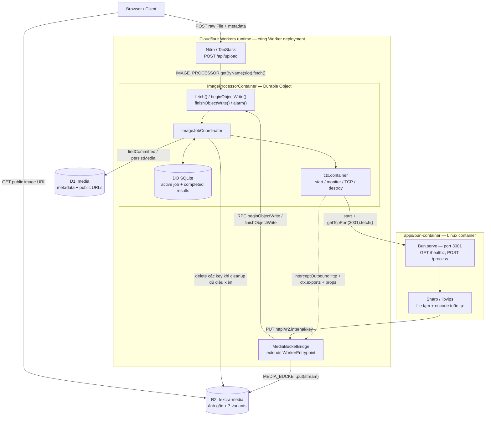
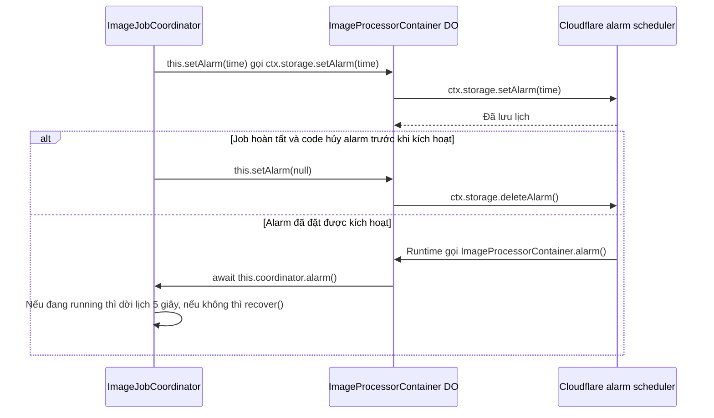
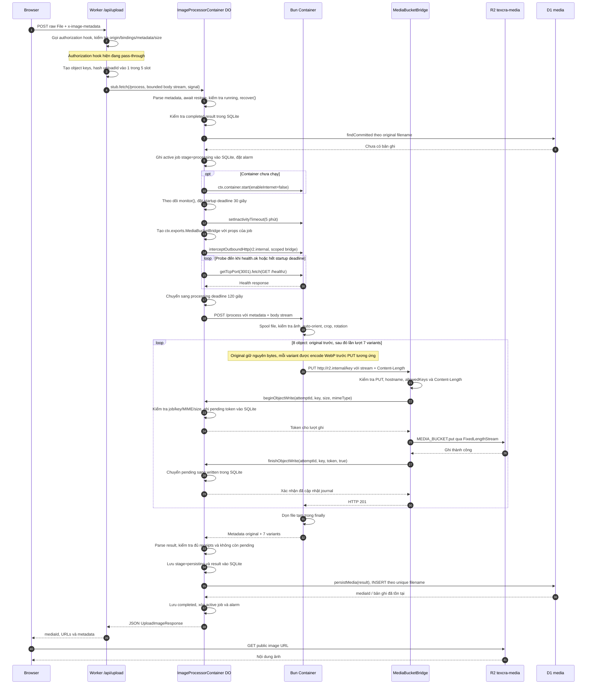
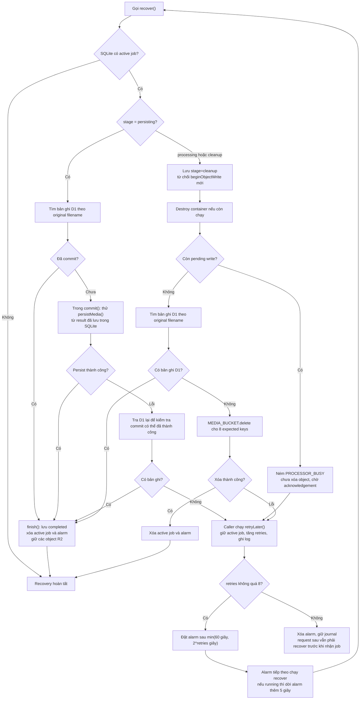

# Plan: Sơ đồ luồng chạy Worker → Durable Object → Container

**Ngày đối chiếu:** 2026-10-19.  
**Mục tiêu:** Ghi lại luồng chạy theo code hiện tại, làm rõ các thành phần, ai gọi từng method, thứ tự xử lý và phục hồi lỗi.  
**Tài liệu liên quan:** [DO-CONTAINER-ACCESS.md](./DO-CONTAINER-ACCESS.md), [0-pre-process-image-plan.md](./0-pre-process-image-plan.md).

Các sơ đồ dưới đây mô tả implementation hiện có. Việc xác nhận chạy end-to-end trên Cloudflare cần cấu hình môi trường và kiểm thử triển khai riêng.

## 1. Thành phần và ranh giới thực thi



`MediaBucketBridge` là entrypoint riêng trong cùng Worker deployment, nằm ngoài state của Durable Object. DO cấu hình interceptor và cấp quyền ghi; Bridge thực hiện ghi R2 rồi xác nhận về đúng DO sở hữu job.

| Thành phần                | Trách nhiệm trong code                                                                 |
| ------------------------- | -------------------------------------------------------------------------------------- |
| Worker `/api/upload`      | Kiểm tra request, tạo object keys, chọn một trong 5 slot và chuyển body stream tới DO. |
| `ImageProcessorContainer` | Xử lý HTTP/RPC, khôi phục inactivity timeout và chuyển job/alarm tới coordinator.      |
| `ImageJobCoordinator`     | Quản lý container, SQLite/R2/D1, job đang chạy, kết quả đã hoàn tất và recovery.       |
| Bun + Sharp               | Spool ảnh ra đĩa, kiểm tra ảnh, xử lý crop/rotation, encode và upload tuần tự.         |
| `MediaBucketBridge`       | Kiểm tra PUT/key/length, xin quyền từ DO, stream vào R2, xác nhận kết quả ghi.         |
| D1                        | Lưu một bản ghi `media` chứa metadata ảnh gốc và 7 variants.                           |

## 2. Vai trò của `exports.cloudflare.ts`

```typescript
export { ImageProcessorContainer } from './src/server/image-processor'
export { MediaBucketBridge } from './src/server/media-bucket-bridge'
```

Nitro nhận diện file này và đưa hai named exports vào entrypoint Cloudflare, cùng default handler của ứng dụng.

| Export                    | Cách sử dụng                                                                                                                             |
| ------------------------- | ---------------------------------------------------------------------------------------------------------------------------------------- |
| `ImageProcessorContainer` | `wrangler.toml` gắn cả container và binding `IMAGE_PROCESSOR` vào class này; storage là SQLite. Worker gọi DO qua `env.IMAGE_PROCESSOR`. |
| `MediaBucketBridge`       | DO tạo scoped fetcher bằng `this.ctx.exports.MediaBucketBridge({ props })` rồi gắn vào outbound interception cho `r2.internal`.          |

Props của Bridge gồm `ownerId`, `attemptId`, `uploadId`, `allowedKeys`. `ownerId` giúp Bridge gọi RPC về đúng DO; `attemptId` giới hạn quyền theo lượt xử lý. Token do `beginObjectWrite()` trả về được Bridge giữ để xác nhận lượt ghi, không phải token browser hay container phải gửi trong HTTP header.

## 3. Các method của DO: ai gọi và gọi khi nào?

**Lập trình viên viết logic và thiết lập tác nhân kích hoạt; Cloudflare chuyển request, RPC hoặc sự kiện alarm đến đúng DO.** `fetch()` và `alarm()` là các handler theo quy ước của Cloudflare. `beginObjectWrite()` và `finishObjectWrite()` là method do project tự định nghĩa trên DO; `process()` là helper nội bộ của `ImageJobCoordinator`. [Cloudflare: Durable Object Base Class](https://developers.cloudflare.com/durable-objects/api/base/).

| Method trong `ImageProcessorContainer` | Loại                            | Ai kích hoạt trong project?                                                              | Khi nào chạy?                                                       |
| -------------------------------------- | ------------------------------- | ---------------------------------------------------------------------------------------- | ------------------------------------------------------------------- |
| `constructor(ctx, env)`                | Khởi tạo instance               | Cloudflare runtime                                                                       | Khi cần tạo hoặc dựng lại instance để xử lý request, RPC hay alarm. |
| `fetch(request)`                       | HTTP handler của DO             | Code Worker gọi `stub.fetch(...)`; Cloudflare chuyển request vào handler                 | Khi `/api/upload` chuyển request tới slot đã chọn.                  |
| `alarm()`                              | Alarm handler của DO            | Code đặt lịch qua `ctx.storage.setAlarm(time)`; Cloudflare gọi handler khi alarm đến hạn | Khi alarm đã đặt được kích hoạt; không cần browser gửi request mới. |
| `beginObjectWrite(...)`                | Custom method, được gọi qua RPC | Code `MediaBucketBridge.fetch()` gọi `owner.beginObjectWrite(...)`                       | Sau kiểm tra request PUT, trước khi bắt đầu ghi object vào R2.      |
| `finishObjectWrite(...)`               | Custom method, được gọi qua RPC | Code `MediaBucketBridge.fetch()` gọi `owner.finishObjectWrite(...)` trong `finally`      | Khi kết thúc thao tác ghi đã được cấp token, để báo kết quả về DO.  |

### `constructor()`: Cloudflare quản lý việc tạo instance

`getByName(...)` tạo stub để liên lạc. Khi có lời gọi/sự kiện tới DO chưa có instance hoạt động, runtime gọi constructor trước rồi mới chạy handler hoặc RPC tương ứng. Constructor có thể chạy lại khi instance được dựng lại; không chạy lại cho từng request nếu instance vẫn được giữ trong bộ nhớ. [Cloudflare: DO lifecycle](https://developers.cloudflare.com/durable-objects/concepts/durable-object-lifecycle/).

Trong [image-processor.ts](../apps/worker/src/server/image-processor.ts), constructor gọi `super(ctx, env)`, khôi phục inactivity timeout nếu container đang chạy, rồi khởi tạo `new ImageJobCoordinator(ctx, env)`. Coordinator tự khởi tạo SQLite store và trực tiếp điều khiển container, D1, R2, alarm và logging; không truyền callback `process` hay object operations.

Các interface nằm trong [image-job-types.ts](../apps/worker/src/server/image-job-types.ts). Constructor của [image-job-coordinator.ts](../apps/worker/src/server/image-job-coordinator.ts) chỉ khởi tạo journal đồng bộ; processing và recovery chạy từ `run()` hoặc `alarm()`.

### `fetch()`: code gửi request, runtime gọi handler

Điểm gọi nằm trong [upload-handler.ts](../apps/worker/src/server/upload-handler.ts):

```text
Browser POST /api/upload
  → handleImageUpload(request, env)
  → env.IMAGE_PROCESSOR.getByName(processorSlot(uploadId))
  → stub.fetch('http://image-processor/process', ...)
  → Cloudflare chuyển request tới DO tương ứng
  → ImageProcessorContainer.fetch(request)
  → this.coordinator.run(metadata, request.body, request.signal)
```

`fetch()` trong DO kiểm tra method/path/body, parse metadata, chờ `restore`, gọi coordinator rồi trả JSON hoặc lỗi. Việc export class chỉ làm class khả dụng cho runtime; request cụ thể ở đây bắt đầu từ dòng `stub.fetch(...)`. [Cloudflare: invoking the fetch handler](https://developers.cloudflare.com/durable-objects/best-practices/create-durable-object-stubs-and-send-requests/#invoking-the-fetch-handler).

Khi DO gọi `port.fetch('http://container/process', ...)`, đích nhận là HTTP server Bun trong container. Đây là bước chuyển tiếp sau đó của luồng upload.

### `alarm()`: lập trình viên đặt lịch, Cloudflare gọi khi đến hạn

Trong [image-job-coordinator.ts](../apps/worker/src/server/image-job-coordinator.ts), coordinator đặt alarm ngay sau khi ghi active job, trước khi gọi `this.process(...)`:

```typescript
await this.this.setAlarm(
  Date.now() +
    IMAGE_PROCESSING_LIMITS.startupMs +
    IMAGE_PROCESSING_LIMITS.processingMs +
    5_000,
)
```

Với các giá trị hiện tại, mốc đặt là **thời điểm đó + 30 giây + 120 giây + 5 giây = 155 giây**. Method `this.setAlarm(time)` gọi trực tiếp `ctx.storage.setAlarm(time)` hoặc `ctx.storage.deleteAlarm()` khi `time === null`.



`ImageProcessorContainer.alarm()` là handler runtime nhận biết. `ImageJobCoordinator.alarm()` là method thường của một class TypeScript; nó chạy vì handler DO gọi `await this.coordinator.alarm()`.

Các quyết định đặt/hủy lịch trong code hiện tại:

- Nhận job mới: đặt mốc 155 giây để có đường phục hồi nếu công việc bị gián đoạn.
- Alarm chạy lúc coordinator còn `running`: đặt alarm tiếp theo sau 5 giây.
- Recovery lỗi: `retryLater()` tăng bộ đếm và đặt lại lịch theo backoff đã mô tả ở mục 6.
- Commit hoặc cleanup hoàn tất: gọi `this.setAlarm(null)`, tương ứng `deleteAlarm()`.

Khai báo `alarm()` chưa tạo lịch chạy. Mỗi DO có một alarm được đặt tại một thời điểm; `setAlarm()` mới thay thế lịch cũ. Alarm có thể gọi lại nếu handler ném lỗi chưa được bắt. Cơ chế retry của runtime tách biệt với bộ đếm `job.retries` do project quản lý. [Cloudflare: Alarms](https://developers.cloudflare.com/durable-objects/api/alarms/).

Các `setTimeout()` cho startup/processing trong `process()` chạy callback abort/reject của code; chúng không gọi `alarm()`. Container crash cũng không trực tiếp gọi `alarm()`: lỗi được theo dõi qua `monitor()`, còn alarm phụ thuộc lịch đã đặt.

### `beginObjectWrite()` và `finishObjectWrite()`: code Bridge chủ động gọi RPC

[MediaBucketBridge.fetch()](../apps/worker/src/server/media-bucket-bridge.ts) lấy stub của DO sở hữu job bằng `props.ownerId`, rồi gọi:

```typescript
const owner = this.env.IMAGE_PROCESSOR.get(
  this.env.IMAGE_PROCESSOR.idFromString(props.ownerId),
)
const token = await owner.beginObjectWrite(
  props.attemptId,
  key,
  length,
  contentType,
)
```

Cloudflare chuyển lời gọi RPC đến method cùng tên trên DO. Lời gọi RPC này đi thẳng vào `beginObjectWrite()`, không đi qua `ImageProcessorContainer.fetch()`. Tên method do lập trình viên chọn; runtime không tự suy ra rằng mỗi lần ghi R2 phải gọi method này. [Cloudflare: invoking RPC methods](https://developers.cloudflare.com/durable-objects/best-practices/create-durable-object-stubs-and-send-requests/#invoke-rpc-methods).

`beginObjectWrite()` gọi `coordinator.beginWrite()` để kiểm tra job, attempt, key, kích thước và MIME. Nếu hợp lệ, nó lưu token trong `pending` rồi trả token cho Bridge. Sau đó Bridge mới stream vào R2.

Khi thao tác ghi kết thúc, đoạn `finally` của Bridge thực hiện:

```typescript
await owner.finishObjectWrite(props.attemptId, key, token, written)
```

`finishObjectWrite()` gọi `coordinator.finishWrite()`. Nếu attempt/token còn hợp lệ, coordinator bỏ entry `pending`; khi `written === true` thì ghi thêm receipt vào `written`. Lời xác nhận cũ hoặc không khớp bị bỏ qua. Khi lỗi làm lượt RPC xác nhận không tới được DO, `pending` có thể còn lại như mô tả ở mục 6.

Đối với một upload mới thành công, Bridge gọi mỗi method **8 lần**, tương ứng ảnh gốc và 7 variants. R2 chỉ trả kết quả PUT cho Bridge; chính code Bridge gửi acknowledgement về DO.

### `process()`: method nội bộ của coordinator

Sau khi ghi active job và đặt alarm, `run()` gọi trực tiếp:

```typescript
await this.process(job, body, signal)
```

Chuỗi gọi thực tế là `ImageProcessorContainer.fetch()` → `coordinator.run()` → `ImageJobCoordinator.process(...)`. Helper này điều khiển startup, health check, interception và request tới Bun. Đường dẫn `/process` được code `fetch()` kiểm tra thủ công; tên đường dẫn không tự ánh xạ sang method `process()`.

Tương tự, `ctx.container.start()`, `ctx.container.monitor()` và `ctx.storage.setAlarm()` là API mà code chủ động gọi. Phần Cloudflare tự thực hiện là dispatch request/RPC, quản lý instance và phát sự kiện alarm theo lịch.

## 4. Sequence diagram: một upload mới thành công

Điều kiện của sơ đồ này: request hợp lệ, slot nhận được job, recovery trước đó đã hoàn tất và chưa có kết quả cho upload này. Các nhánh từ chối/replay được ghi ở mục 5.



Các chi tiết cần giữ khi đọc sơ đồ:

- Worker gọi **DO stub**; DO chuyển stream vào container qua `getTcpPort(3001).fetch()`.
- Interception được cài **trước health check và trước `/process`**, áp dụng lại theo từng job.
- DO khôi phục inactivity timeout trong constructor nếu container vẫn chạy sau khi DO được dựng lại.
- Bridge chờ cả stream pipeline và R2 PUT hoàn tất, sau đó `await finishObjectWrite()` trong `finally` trước khi trả kết quả cho container.
- Có **8 object**: `original`, `thumbnail`, `square`, `small`, `medium`, `large`, `xlarge`, `og`. Các variants được encode/upload lần lượt.
- Container nhận stream và metadata, dùng HTTP bridge để ghi ảnh; các binding D1/R2 nằm ở tầng Worker/DO/Bridge.

## 5. Nhận job, từ chối và trả lại kết quả đã có

Thứ tự dưới đây nằm trong `ImageJobCoordinator.run()` sau khi DO parse metadata và chờ `restore`:

| Thứ tự | Điều kiện                                 | Hành vi                                                                                                                        |
| ------ | ----------------------------------------- | ------------------------------------------------------------------------------------------------------------------------------ |
| 1      | `running === true`                        | Trả `PROCESSOR_BUSY` trước khi coordinator đọc body; không xếp hàng job trong bộ nhớ.                                          |
| 2      | Slot không bận                            | Đặt `running = true`, gọi `recover()` để kiểm tra active job cũ. Nếu recovery lỗi, giữ journal, gọi `retryLater()` và trả lỗi. |
| 3      | SQLite có completed result cho `uploadId` | Metadata trùng thì trả kết quả cũ; metadata khác thì trả `INVALID_INPUT`.                                                      |
| 4      | D1 đã có original filename                | Lưu completed result vào SQLite và trả kết quả đã commit.                                                                      |
| 5      | Chưa có kết quả và signal chưa abort      | Tạo `attemptId`, ghi active job, đặt alarm và bắt đầu xử lý như mục 4.                                                         |

`running` được reset trong `finally` của `run()`. Việc còn active job trong journal vẫn buộc request tiếp theo phải recovery trước khi nhận job mới.

Slot có tên `image-processor-0` đến `image-processor-4`, tính bằng hash của `uploadId`. Request tới slot bận có thể bị từ chối dù slot khác đang rảnh; code hiện không tự chuyển upload sang slot khác.

## 6. Sơ đồ phục hồi lỗi

`recover()` được gọi trước khi nhận job mới, trong nhánh bắt lỗi xử lý/commit, và từ `alarm()`. Sơ đồ sau mô tả logic bên trong `recover()` cùng cách caller xử lý khi recovery ném lỗi.



Lỗi khi đọc D1 hoặc dừng container cũng làm recovery ném lỗi và đi vào `retryLater()` nếu journal vẫn còn active job. Nếu `setAlarm()` hoặc thao tác storage tự thất bại, lỗi có thể tiếp tục truyền ra caller; sơ đồ không coi việc đặt retry luôn thành công.

Các hành vi phục hồi cần phân biệt:

- **Lỗi processing/upload:** chuyển sang `cleanup`, dừng container và chỉ xóa R2 khi không còn pending write, đồng thời xác nhận D1 chưa commit.
- **Lỗi ở stage `persisting`:** kiểm tra D1 và thử commit lại từ result đã lưu. Nhánh này giữ các object R2.
- **Mất acknowledgement:** entry `pending` vẫn tồn tại; slot bị giữ lại để tránh cleanup chạy đua với một R2 PUT chưa xác định kết quả. Chỉ destroy container chưa đủ để coi lượt ghi đã hoàn tất.
- **Alarm:** phục hồi commit hoặc cleanup; không tự chạy lại Sharp từ request body cũ. Một lần xử lý ảnh mới cần request gửi lại body.
- **Giới hạn retry:** các lần lỗi recovery 1–8 đặt lại alarm. Từ lần thứ 9, code xóa alarm nhưng giữ journal; request sau vẫn có thể kích hoạt recovery.
- **Kết quả trả về:** nếu recovery tìm được completed result thì `run()` trả thành công. Nếu chỉ cleanup xong thì request đang lỗi tiếp tục trả lỗi. Alarm chạy sau khi request đã kết thúc không gửi thêm response cho browser.

R2 và D1 không có transaction chung. Tính nhất quán được xử lý bằng journal trong DO, receipts của các lần ghi, kiểm tra D1, commit có thể thử lại và cleanup có điều kiện.

## 7. Code dùng để đối chiếu

| Nội dung                                      | File                                                                           |
| --------------------------------------------- | ------------------------------------------------------------------------------ |
| Named exports                                 | [exports.cloudflare.ts](../apps/worker/exports.cloudflare.ts)                  |
| Binding, container, SQLite và biến môi trường | [wrangler.toml](../apps/worker/wrangler.toml)                                  |
| Nitro Cloudflare preset                       | [vite.config.ts](../apps/worker/vite.config.ts)                                |
| HTTP route                                    | [api/upload.ts](../apps/worker/src/routes/api/upload.ts)                       |
| Validation, slot và chuyển stream             | [upload-handler.ts](../apps/worker/src/server/upload-handler.ts)               |
| Authorization hook hiện tại                   | [upload-authorization.ts](../apps/worker/src/server/upload-authorization.ts)   |
| DO lifecycle, interceptor và RPC              | [image-processor.ts](../apps/worker/src/server/image-processor.ts)             |
| Admission, receipts, commit và recovery       | [image-job-coordinator.ts](../apps/worker/src/server/image-job-coordinator.ts) |
| Kiểu dữ liệu và contract của image job        | [image-job-types.ts](../apps/worker/src/server/image-job-types.ts)             |
| SQLite journal                                | [image-job-store.ts](../apps/worker/src/server/image-job-store.ts)             |
| Ghi R2 và acknowledgement                     | [media-bucket-bridge.ts](../apps/worker/src/server/media-bucket-bridge.ts)     |
| D1 persistence và lookup                      | [media.ts](../apps/worker/src/server/media.ts)                                 |
| Bun HTTP server                               | [server.ts](../apps/bun-container/src/server.ts)                               |
| Sharp, file tạm và thứ tự upload              | [processor.ts](../apps/bun-container/src/processor.ts)                         |
| HTTP client tới r2.internal                   | [storage.ts](../apps/bun-container/src/storage.ts)                             |
| Giới hạn và timeout                           | [constants.ts](../packages/shared/src/image-processing/constants.ts)           |

Điều kiện để chạy luồng thành công trên môi trường triển khai: binding D1/R2/container hoạt động và `MEDIA_PUBLIC_BASE_URL` hợp lệ. Trong `wrangler.toml` hiện tại, D1 ID vẫn là placeholder và public R2 URL đang trống.
