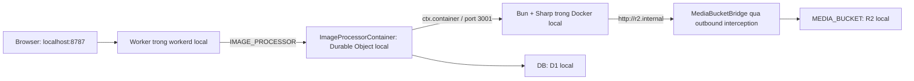

# Kế hoạch chạy Worker và Container trực tiếp trên local

Ngày khảo sát: 2026-10-17. Trạng thái: **chờ người dùng duyệt; chưa triển khai**.

## 1. Đề xuất

Dùng Docker Engine đang có trên máy, cấp quyền truy cập đúng cho user chạy Wrangler, rồi chạy bản build Nitro bằng `wrangler dev --local`. Giữ `IMAGE_PROCESSOR` và `ImageProcessorContainer` như cấu hình hiện tại.

Luồng cần kiểm chứng:



Wrangler quản lý image và các Container local; ứng dụng điều phối vòng đời qua Durable Object. Không cần tự chạy một Container riêng bằng Docker Compose hoặc thay binding bằng URL `localhost:3001`. Cấu hình Container, namespace và class export phải trùng tên. [Cloudflare Container configuration](https://developers.cloudflare.com/containers/configuration/wrangler/)

## 2. Kết quả khảo sát thực tế

| Hạng mục               | Kết quả                                                                                                       |
| ---------------------- | ------------------------------------------------------------------------------------------------------------- |
| Máy phát triển         | Ubuntu 26.04.1 LTS, Linux amd64                                                                               |
| Docker CLI             | Có tại `/usr/local/bin/docker`, symlink tới `/usr/bin/docker`; client 29.9.0                                  |
| Docker socket          | `/var/run/docker.sock`, owner `root:docker`, quyền `srw-rw----`                                               |
| User chạy lệnh         | `tien`, UID 1000; cả nhóm của phiên hiện tại và membership trong hệ thống đều chưa có `docker`                |
| `docker version`       | In được Client, nhưng kết nối Server trả `permission denied`                                                  |
| Kiểm tra ngoài sandbox | Vẫn cùng lỗi socket; xác nhận đây là vấn đề quyền trên host                                                   |
| Wrangler cài thực tế   | 4.149.0; manifest khai báo `^4.147.0`                                                                         |
| Container image        | `apps/bun-container/Dockerfile`, context là root monorepo                                                     |
| Runtime Container      | Bun 1.4.3, HTTP lắng nghe `0.0.0.0:3001`                                                                      |
| Binding                | `IMAGE_PROCESSOR → ImageProcessorContainer`, SQLite DO qua `[exports.ImageProcessorContainer]`                |
| Build Worker           | Nitro; `main = ".output/server/index.mjs"`                                                                    |
| Config sau build       | `.wrangler/deploy/config.json` trỏ tới `.output/server/wrangler.json`; đã có script rebase Dockerfile/context |
| Media origin           | `MEDIA_PUBLIC_BASE_URL = ""`; upload handler kiểm tra giá trị này trước khi gọi DO                            |

**Nguyên nhân đã xác định:** user chưa có quyền sử dụng Docker socket. Trong mã Wrangler cài trên máy, `isDockerRunning()` thực thi `docker info`; mọi lỗi bị chuyển thành `false`, rồi `verifyDockerInstalled()` phát thông báo “Docker CLI ... could not be launched”. Vì vậy câu báo lỗi này cũng xuất hiện khi Docker đã được cài nhưng không truy cập được daemon.

Chưa kết luận daemon đang hoạt động bình thường, vì quyền socket hiện chặn việc đọc trạng thái Server. Sau khi sửa quyền phải kiểm tra lại `docker info`.

Nguồn trong repository đã đối chiếu:

- `apps/worker/wrangler.toml`, `apps/worker/exports.cloudflare.ts`.
- `apps/worker/scripts/finalize-build.ts`, `.output/server/wrangler.json` và `.wrangler/deploy/config.json` hiện có.
- `apps/worker/src/server/image-processor.ts`, `upload-handler.ts`, `image-http.ts`.
- `apps/bun-container/Dockerfile`, `apps/bun-container/src/server.ts`.
- `apps/worker/node_modules/wrangler/wrangler-dist/cli.js`: `isDockerRunning`, `verifyDockerInstalled`, `resolveDockerHost`.

Đã chạy intent skill discovery tại workspace root và nạp `start-core`, `start-core/deployment`; đối chiếu thêm skill `wrangler`. Chỉ khảo sát và tạo tài liệu này, chưa sửa mã ứng dụng hoặc cấu hình máy.

## 3. Các phương án

| Phương án                                      | Mức thay đổi                                                 | Đánh giá                                                                               |
| ---------------------------------------------- | ------------------------------------------------------------ | -------------------------------------------------------------------------------------- |
| **A. Docker Engine hiện tại + Wrangler local** | Sửa quyền Docker; chuẩn hóa scripts và tài liệu              | **Khuyến nghị**, phù hợp trực tiếp cấu hình hiện có                                    |
| B. Docker rootless + Wrangler local            | Thiết lập daemon/context/socket riêng cho user               | Phù hợp nếu không muốn cấp quyền nhóm `docker`; cần kiểm tra thêm networking và bridge |
| C. Chuyển sang Cloudflare Vite plugin          | Thay đổi tích hợp framework, entrypoint và cách lấy bindings | Chỉ xem xét riêng nếu cần HMR trong Workers runtime; chưa cần để giải quyết lỗi Docker |

Docker rootless chạy daemon và Container dưới user thường. Nếu chọn B, kiểm tra prerequisites, dùng socket rootless thực tế và đặt `DOCKER_HOST` tương ứng; không vô hiệu hóa daemon hiện tại vì có thể phục vụ công việc khác. [Docker rootless](https://docs.docker.com/engine/security/rootless/)

Phương án A giữ Nitro và hỗ trợ build Node.js đã có. Tài liệu Nitro hướng dẫn local preview bằng build rồi Wrangler, đồng thời hỗ trợ named exports qua `exports.cloudflare.ts`. [Nitro Cloudflare](https://nitro.build/deploy/providers/cloudflare)

## 4. Các việc thực hiện sau khi duyệt

### P1 — Khôi phục quyền Docker trên máy phát triển

1. Với A, thêm user `tien` vào nhóm đã tồn tại:

   ```bash
   sudo usermod -aG docker tien
   ```

2. Đăng xuất/đăng nhập lại và mở lại terminal/IDE chạy Wrangler để nhận nhóm mới. Có thể dùng `newgrp docker` cho một shell mới; IDE đang chạy không tự nhận membership mới.
3. Chạy trong chính môi trường sẽ khởi động Wrangler:

   ```bash
   id
   docker version
   docker info
   ```

4. Nếu sau khi sửa quyền xuất hiện lỗi daemon chưa chạy, kiểm tra service và chỉ khởi động Docker khi cần.
5. Nếu Docker chạy được nhưng Wrangler vẫn lỗi, kiểm tra binary mà `WRANGLER_DOCKER_BIN` chọn, context và `DOCKER_HOST`/`WRANGLER_DOCKER_HOST`. Chỉ đặt override khi xác định đang trỏ sai; override đường dẫn không sửa được quyền socket.

**Tiêu chí hoàn thành:** `docker info` thoát thành công dưới user thường, đọc được Server từ cùng phiên chạy pnpm.

Nhóm `docker` cấp quyền tương đương root thông qua daemon; đây là lựa chọn quyền hệ thống cần được duyệt cùng phương án A. Không dùng `chmod 666` cho socket hoặc chạy toàn bộ pnpm bằng sudo. [Docker Linux post-installation](https://docs.docker.com/engine/install/linux-postinstall/)

### P2 — Chuẩn hóa workflow Nitro → Wrangler

1. Thêm script kiểm tra local, dự kiến `apps/worker/scripts/check-local-dev.ts`: kiểm tra Docker CLI/daemon, báo rõ lỗi quyền/socket và trả exit code khác 0 trước khi build nếu không đạt. Script chỉ chẩn đoán, không tự sửa quyền hệ thống.
2. Thêm các scripts dự kiến:

   | Script tại root                    | Hành vi                                                   |
   | ---------------------------------- | --------------------------------------------------------- |
   | `pnpm run worker:doctor`           | Kiểm tra điều kiện Docker/local                           |
   | `pnpm run worker:dev:local`        | Doctor → build Nitro bằng script hiện có → Wrangler local |
   | `pnpm run worker:db:migrate:local` | Apply migration vào cùng vùng lưu trữ local với phiên dev |

3. Dùng bản build Cloudflare, kiểm tra `ImageProcessorContainer` và `MediaBucketBridge` có trong named exports. Nếu đang đặt `NITRO_PRESET=node-server`, báo rõ hoặc chọn Cloudflare cho script local chuyên dụng.
4. Tiếp tục dùng `finalize-build.ts` để rebase paths; kiểm tra generated config giữ `ASSETS`, Container, DO, R2 và D1. Không chỉnh generated config thủ công.
5. Chỉ định config sau build khi chạy local để dùng đúng assets và entrypoint. Chọn một đường dẫn persistence tuyệt đối, được script tính từ workspace; migration và Wrangler phải dùng cùng đường dẫn đó.
6. Giữ `pnpm run dev` cho Vite/Nitro hiện có. Đây chưa phải bằng chứng Container chạy đúng: Nitro dev đang dùng `getPlatformProxy()` và có thể fallback sang bindings rỗng khi khởi tạo lỗi.

Lệnh tương đương dự kiến, chạy từ root sau P1; **chưa thực thi trong giai đoạn lập kế hoạch**:

```bash
pnpm --config.verify-deps-before-run=false --filter worker run build
pnpm --config.verify-deps-before-run=false --filter worker exec wrangler d1 migrations apply texcra-db --local --config .output/server/wrangler.json --persist-to /home/tien/Documents/code/texcra/apps/worker/.wrangler/state
pnpm --config.verify-deps-before-run=false --filter worker exec wrangler dev --local --config .output/server/wrangler.json --ip 127.0.0.1 --port 8787 --persist-to /home/tien/Documents/code/texcra/apps/worker/.wrangler/state --var MEDIA_PUBLIC_BASE_URL:http://localhost:8787
```

Các lệnh trên phục vụ chạy runtime và kiểm thử upload; URL ảnh chỉ đọc được sau phần P4. Truy cập UI bằng `http://localhost:8787` để giữ một origin thống nhất.

Kiểm tra migration discovery từ config đã sinh trước khi apply; không tạo lại hoặc sửa schema chỉ để chạy local. `database_id` hiện là placeholder: xác nhận Wrangler chấp nhận cho emulation, nếu cần thay thì dùng giá trị local riêng, không yêu cầu tạo database Cloudflare để hoàn thành workflow local.

### P3 — Kiểm chứng điều phối Container và bindings thật trên local

1. Khởi động Wrangler với Docker đã hoạt động. Để Wrangler build image từ Dockerfile và root context hiện tại.
2. Kiểm tra log cho `IMAGE_PROCESSOR`, `MEDIA_BUCKET`, `DB`; dùng `--local` để tắt remote bindings.
3. Gửi một upload đúng contract của `/api/upload`: raw image body và `x-image-metadata`. Kiểm tra request thực sự đi qua DO, `ctx.container.start()`, readiness `/healthz`, và `/process` tại port 3001.
4. Kiểm tra outbound interception đến `r2.internal` ghi original + 7 variants vào R2 local; kiểm tra record media ở D1 local sau khi upload thành công.
5. Kiểm tra upload lần đầu và lần tiếp theo, phản hồi busy khi cùng slot, và Container được dừng khi kết thúc dev session. Dùng UUID fixture riêng để không nhầm dữ liệu cũ.

Cloudflare hỗ trợ Worker và Container chạy cùng máy qua Wrangler. Container khởi động theo lời gọi ứng dụng; `max_instances` không được áp dụng ở local. Code hiện có hash upload vào năm slot và kiểm soát một job/slot, nên dùng kiểm thử tải nhỏ phù hợp máy. [Container local development](https://developers.cloudflare.com/containers/guides/local-dev/)

R2 trong local mode lưu dữ liệu trên máy. Không dùng domain R2 production để suy luận ảnh local đã được ghi thành công. [R2 Workers API](https://developers.cloudflare.com/r2/api/workers/workers-api-usage/)

### P4 — Tùy chọn: xem ảnh upload hoàn toàn trên local

Phần này nên làm nếu mục tiêu bao gồm thao tác upload và xem ảnh trong UI. Nếu chỉ cần Worker điều phối Container và xác nhận lưu dữ liệu, có thể dừng ở P3.

1. Dùng `MEDIA_PUBLIC_BASE_URL=http://localhost:8787` trong lệnh dev, không ghi đè origin production trong config gốc. Validator hiện tại đã chấp nhận HTTP origin, nhưng không chấp nhận base URL chứa pathname.
2. Thêm route đọc `GET/HEAD /media/$` khớp object key hiện tại `media/<uploadId>/...`; lấy stream qua `MEDIA_BUCKET.get()`, giữ content type và ETag, trả 404 khi không có object. Không thêm quyền upload/delete qua route này.
3. Route chỉ bật qua cờ runtime local rõ ràng, mặc định tắt. Script dev truyền cờ cùng origin; production thiếu cờ phải trả 404. Không dùng `NODE_ENV` để nhận diện Wrangler local vì ứng dụng đang chạy bản build.
4. Sinh lại Cloudflare types nếu thêm biến cấu hình; dùng kiểu và cách lấy bindings theo request hiện có.
5. Kiểm tra URL original, thumbnail và các variants trên browser. Khi tắt cờ local, route phải không phục vụ dữ liệu.

Nếu không chọn P4, origin local chỉ giúp upload handler qua validation và tạo URL trong kết quả; những URL đó chưa có endpoint để trả ảnh. Điều này phải được ghi rõ trong README và kết quả kiểm thử.

### P5 — Tài liệu và kiểm tra cuối

- Cập nhật README với prerequisites, nhóm Docker, scripts, state directory, cách xử lý lỗi Docker và phạm vi P4.
- Thay đổi Worker/server source: chạy lại build rồi khởi động lại Wrangler ở giai đoạn đầu. Wrangler đang quan sát artifact build, không biên dịch source Nitro thay cho Vite.
- Thay đổi Container source: rebuild image bằng phím `r` trong terminal Wrangler tương tác hoặc khởi động lại session. [Container iteration](https://developers.cloudflare.com/containers/guides/local-dev/#iterating-on-container-code)
- Chạy typecheck và các test upload/D1 hiện có phù hợp phần thay đổi. Nếu làm P4, thêm test có ý nghĩa cho cờ bật/tắt, object thiếu, GET/HEAD và content type; chạy một upload thực qua Docker để kiểm chứng tích hợp.
- Báo riêng kết quả build, runtime, storage và UI. Build hoặc dry run thành công chưa chứng minh luồng DO → Container → bridge hoạt động.

## 5. Phạm vi file dự kiến

| File                                                                 | Thay đổi                                                                     |
| -------------------------------------------------------------------- | ---------------------------------------------------------------------------- |
| `package.json`                                                       | Scripts gọi workflow local của worker                                        |
| `apps/worker/package.json`                                           | Doctor, build/start local và migration dùng cùng persistence                 |
| `apps/worker/scripts/check-local-dev.ts`                             | Chẩn đoán Docker và điều kiện local                                          |
| `apps/worker/scripts/dev-local.ts`                                   | Nếu cần launcher để tính paths, truyền biến và quản lý tiến trình            |
| `README.md`                                                          | Hướng dẫn chạy và troubleshooting                                            |
| `apps/worker/src/routes/media/$.ts`                                  | Chỉ khi chọn P4: đọc ảnh R2 local                                            |
| `apps/worker/src/server/local-media.ts`                              | Chỉ khi chọn P4: xử lý stream và cờ bật/tắt                                  |
| `apps/worker/wrangler.toml`, `worker-configuration.d.ts`, route tree | Chỉ khi cần biến local/types/route mới; giữ cấu hình Container tại dòng 8–22 |
| `apps/worker/tests/*`                                                | Chỉ bổ sung cho hành vi mới ở P4                                             |

Dockerfile và `image-processor.ts` chỉ cần sửa nếu kiểm thử phát hiện lỗi cụ thể; hiện chưa có bằng chứng cần đổi kiến trúc hoặc SDK. Giữ nguyên các thay đổi chưa commit đã có trong workspace và không truy cập thư mục `agent-do-not-touch`.

## 6. Tiêu chí nghiệm thu và quyết định cần duyệt

- Docker hoạt động dưới đúng user/session chạy Wrangler.
- Một lệnh pnpm khởi động được Worker local cùng cấu hình Container hiện có.
- Upload gọi được DO và Container thật, ghi đủ objects vào R2 local và metadata vào D1 local.
- Restart phiên dev dùng lại đúng state; migration và runtime không trỏ sang hai database local khác nhau.
- Nếu chọn P4, UI hiển thị ảnh từ local và route đọc ảnh tắt khi thiếu cờ local.

**Đề nghị duyệt A + P1–P3 + P5.** Bổ sung P4 nếu muốn kiểm thử UI ảnh đầy đủ trên local. Cần xác nhận lựa chọn Docker hiện tại hay rootless, và có bao gồm P4 hay không.

Chưa chạy build, migration, Container, thay đổi nhóm user hoặc chỉnh mã ứng dụng. Theo `AGENTS.md`: “DO NOT PROCEED UNLESS USER APPROVE THE PLAN!” — chỉ triển khai sau khi người dùng duyệt kế hoạch này.
